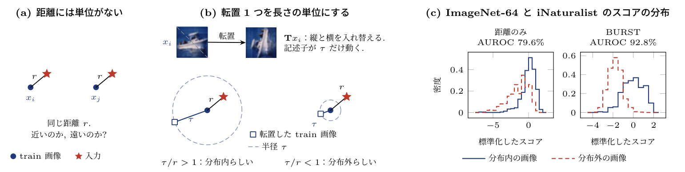
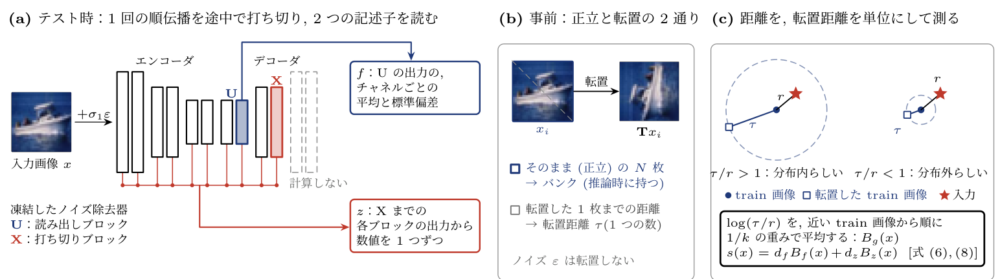
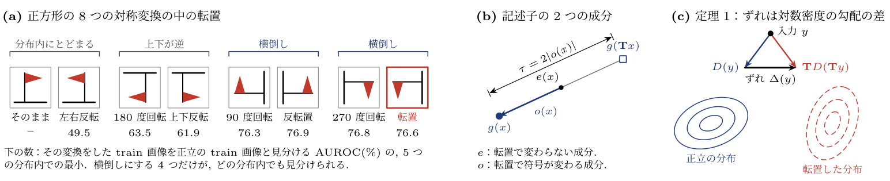

# BURST：破れた対称性による拡散モデルの分布外検知

拡散モデルのノイズ除去器を途中まで1回だけ通して読む中間特徴で、分布外の画像を見分ける手法 **BURST** の原稿(日本語)と、スコアの参照実装です。

入力から学習用の画像(train 画像)までの最近傍の距離には、基準になる長さがありません。BURST は、train 画像とその転置(縦と横を入れ替えた画像)をノイズ除去器に通したときの記述子の距離を「長さの単位」にして、入力までの距離をその単位で割ります。自然画像の分布は縦と横を区別する、すなわち転置という対称性を破っているので、転置した train 画像は「内容は分布内と同じで、分布内ではない画像」になります。この距離が、train 画像のまわりで分布内と分布外がどれだけ離れているかを教えます。

- 学習するパラメータも、当てはめる分類器も、選ぶ近傍数もありません。
- 推論は、途中のブロックで打ち切る1回の順伝播です。計算時間は1回の順伝播の0.54倍、記述子の計算と探索を含めて0.65倍です。
- 事前の計算は、train 画像1枚あたり2回(そのままと転置)の順伝播です。推論時に持つのは、正立の記述子と、train 画像ごとに1つの数(転置距離)だけです。
- 5つの分布内データセットで、自然画像の分布外集合での平均 AUROC は96.5%、FPR95 は13.8%です。同じ拡散モデルを用いる10の先行手法の最良(88.0%、35.9%)を上回ります。



**図1　転置1つが、距離の単位になる。** (a) 最近傍の距離 $`r`$ には基準になる長さがありません。左右の入力(赤い星)は、train 画像(紺の丸)から同じ距離にあります。(b) BURST は、train 画像とその転置(白い四角)をノイズ除去器に通し、2つの記述子の距離 $`\tau`$ を train 画像ごとに1つの数として持ちます。入力までの距離 $`r`$ を $`\tau`$ で割ると、同じ距離でも、$`\tau`$ より近ければ分布内らしく、遠ければ分布外らしくなります。(c) ImageNet-64 を分布内、iNaturalist を分布外とするときのスコアの分布(test 画像、ノイズの種0)。距離だけでは AUROC が79.6%、$`\tau`$ で割ると92.8%です。

原稿：[`paper/BURST_JA_1127c.pdf`](paper/BURST_JA_1127c.pdf)(2026年12月。本文と参考文献の9ページ)<br>
著者：表 紘太朗、尾崎 慶次郎、中澤 仁(慶應義塾大学)

## リポジトリの中身

| パス | 内容 |
|---|---|
| `paper/BURST_JA_1127c.pdf` | 原稿。本文と参考文献の9ページで、付録は含みません |
| `code/burst_score.py` | スコアの参照実装。記述子を受け取ってスコアを返します(記述子を求める順伝播の部分は含みません) |

## 手法



**図2　推論時に持つのは、正立の記述子と、train 画像ごとに1つの数だけ。** (a) テスト時は、凍結したノイズ除去器の1回の順伝播を打ち切りブロック X で止め、読み出しブロック U の出力の平均と標準偏差 $`f`$ と、X までの各ブロックの出力から数値を1つずつ読んだ並び $`z`$ を求めます。(b) 事前に、train 画像を、そのままと転置の2通りで同じように通します。転置した1枚は、転置距離 $`\tau`$ を求めたあとは捨てます。(c) 記述子ごとに、入力から train 画像までの距離 $`r`$ を、その train 画像の $`\tau`$ で割ります。紺は推論時に持つもの、赤は入力です。

### 1. 1回の順伝播と2つの記述子

画像 $`x`$(画素値は $`[-1,1]`$)に小さなノイズ $`\sigma_1\varepsilon`$ を加えて、凍結したノイズ除去器に1回通します。$`\sigma_1=0.01`$ で、$`\varepsilon`$ は標準正規分布から引いた1枚の画像です。$`\varepsilon`$ はノイズの種ごとに1枚で、train 画像、転置した train 画像、入力のすべてに同じものを加えます。順伝播は打ち切りブロック X で止め、その先は計算しません。

**第1の記述子 $`f(x)`$。** 読み出しブロック U の出力について、チャネルごとに位置についての平均と標準偏差を求めて並べ(長さはチャネル数の2倍)、長さ1に正規化したベクトルです。距離は2つのベクトルの差の大きさ、すなわち単位球面上の弦の長さです。

**第2の記述子 $`z(x)`$。** ブロックごとに数値を1つだけ読みます。ブロック $`h`$ の出力のチャネル $`c`$、位置 $`(i,j)`$ の値を $`h_{c,i,j}`$、チャネル $`c`$ の位置についての平均を $`\mu_c`$、チャネルの数を $`C_h`$ として、

```math
a_h(x)=\frac{1}{C_h}\sum_{c=1}^{C_h}\log\max_{i,j}\left|h_{c,i,j}-\mu_c\right|
```

を振幅と呼びます。入力側から X までの振幅を、ブロックごとに正立の train 画像での平均 $`\bar{a}_h`$ と標準偏差 $`\mathrm{sd}_h`$ でそろえて並べます。

```math
z(x)=\left(\frac{a_1(x)-\bar{a}_1}{\mathrm{sd}_1},\ \ldots,\ \frac{a_{\mathrm{X}}(x)-\bar{a}_{\mathrm{X}}}{\mathrm{sd}_{\mathrm{X}}}\right)
```

距離はユークリッド距離です。$`z`$ の長さは X のブロックの番号に等しく、分布内データセットごとに11から28です。

以下、記述子 $`g\in\lbrace f,z\rbrace`$ のそれぞれについて同じ計算をします。

### 2. 転置距離

$`\mathbf{T}`$ を転置(行 $`i`$、列 $`j`$ の画素を行 $`j`$、列 $`i`$ に移す画素の並べ替え)とします。事前に、train 画像 $`x_i`$ と $`\mathbf{T}x_i`$ を、テスト時と同じノイズ(ノイズは転置しません)と打ち切りで通し、

```math
\tau_g(i)=\left|g(x_i)-g(\mathbf{T}x_i)\right|
```

を train 画像ごとに1つの数として持ちます。これを $`x_i`$ の転置距離と呼びます。転置した記述子は、転置距離を求めたら捨てます。

### 3. スコア

入力 $`x`$ と train 画像 $`x_i`$ の記述子の距離を $`r_g(x,i)=|g(x)-g(x_i)|`$ とし、$`N`$ 枚の train 画像をこの距離の近い順に並べた番号を $`i_1,i_2,\ldots,i_N`$ とします。距離を相手の train 画像の転置距離で割り、その対数を順位の逆数の重みで平均します。

```math
B_g(x)=\sum_{k=1}^{N}w_k\log\frac{\tau_g(i_k)}{r_g(x,i_k)}
```

```math
w_k=\frac{1/k}{1+\frac{1}{2}+\cdots+\frac{1}{N}}
```

スコアは2つの記述子の和で、大きいほど分布内らしいことを表します。

```math
s(x)=d_f\,B_f(x)+d_z\,B_z(x)
```

近傍数は選ばず、すべての train 画像を使って近いものほど重くします。比 $`\tau/r`$ には長さの単位がないので、単位の違う $`f`$ と $`z`$ をそのまま足せます。$`d_g`$ は記述子の内在次元で、長さの比を体積の比に直すために掛けます。train 画像から選んだ5000枚について、その画像自身をバンクから除いて $`k`$ 番目の最近傍の距離 $`r_{(k)}`$ を求め、$`-\log r_{(k)}`$ の平均を $`\log k`$($`k=1,2,5,10,20`$)に当てはめた直線の傾き $`-1/d_g`$ から得ます。

### 4. 読み出しブロック U と打ち切りブロック X

ブロックは train 画像だけで、1度だけ選びます。train 画像から選んだ5000枚について、変換した画像を、正立の train 画像への $`R`$ 番目の最近傍の距離で、そのままの画像と見分ける AUROC を、その変換の**見分けやすさ**と呼びます(その画像自身は近傍から除きます)。U は、正方形の対称変換のうち恒等変換を除く7つ(90度・180度・270度の回転、左右反転、上下反転、転置、反転置)の見分けやすさの平均を $`R`$ について最大にした値が、最も大きいブロックです。選択のバンクは train 画像1万枚、$`R\in\lbrace 1,2,5,10,20,50,100,200,500,1000\rbrace`$、ノイズの種は0です。

向きの違いは U より先のデコーダのブロックにも現れるので、$`z`$ は、U の2倍の解像度をもつデコーダのブロックのうち最後のもの(打ち切りブロック X)まで読み、順伝播はそこで止めます。分布内データセットごとの U と X は[下の表](#分布内データセットごとの構成)にあります。

### 推論の流れ

1. **事前(train 画像ごとに2回の順伝播)。** $`x_i+\sigma_1\varepsilon`$ と $`\mathbf{T}x_i+\sigma_1\varepsilon`$ を X まで通して $`f`$ と振幅を読む。正立の train 画像での振幅の平均と標準偏差、$`d_f`$、$`d_z`$、$`\log\tau_f(i)`$、$`\log\tau_z(i)`$ を求め、正立の記述子と合わせてバンクにする。
2. **推論(入力ごとに X で打ち切る1回の順伝播)。** $`x+\sigma_1\varepsilon`$ を X まで通して $`f(x)`$ と $`z(x)`$ を読み、バンクとの距離をすべて計算して $`s(x)`$ を求める。

## 結果

test 画像(各集合500枚)での AUROC(%)です。左の5列は、分布内データセットごとの、自然画像の分布外集合での平均です。「上下反転」は、上下反転した分布内の画像を分布外としたときの AUROC の5つの平均、FPR95 は自然画像の分布外集合での5つの平均(低いほどよい)です。「順伝播」は1枚あたりの回数で、+ のあとは逆伝播の回数です。† は先行研究の中の最良です。

| 手法 | CIFAR-10 | SVHN | CelebA | ImageNet-64 | FashionMNIST | 5つの平均 | 上下反転 | FPR95 | 順伝播 |
|---|---|---|---|---|---|---|---|---|---|
| NLL(尤度) | 57.4 | 99.3 | 80.9 | 54.6 | 32.8 | 65.0 | 57.7 | 62.2 | 128+128 |
| IC(PNG) | 72.7 | 91.6 | 86.5 | 48.9 | 86.3 | 77.2 | 57.9 | 62.5 | 128+128 |
| IC(JPEG2000) | 71.4 | 72.8 | 80.9 | 47.2 | 38.4 | 62.1 | 57.3 | 75.5 | 128+128 |
| TT | 62.1 | 99.0 | 84.6 | 59.8 | 62.1 | 73.5 | 54.4 | 60.8 | 128+128 |
| MSMA 型 | 64.5 | 99.3 | 99.3 | 65.1 | 96.6 | 85.0 | 65.7 | 39.7 | 20 |
| DiffPath | 72.4 | 99.8† | 99.8† | 55.5 | 80.6 | 81.6 | 64.3 | 47.4 | 10 |
| GEPC | 49.9 | 92.0 | 99.0 | 52.0 | 83.9 | 75.4 | 52.5 | 62.4 | 14 |
| EigenScore | 72.8 | 86.3 | 87.4 | 45.2 | 93.8 | 77.1 | 78.6† | 64.1 | 180 |
| CFS | 74.9 | 91.0 | 99.4 | 65.5† | 97.4 | 85.6 | 61.4 | 45.5 | 1 |
| CFS(kNN ヘッド) | 85.4† | 93.8 | 99.6 | 61.3 | 99.8† | 88.0† | 73.6 | 35.9† | 1 |
| 参考：回転の予測(ResNet-18) | 85.9 | 95.1 | 100.0 | 61.4 | 99.3 | 88.3 | 93.9 | 36.2 | 4 |
| 単位なし(距離のみ) | 92.8 | 97.6 | 100.0 | 78.0 | 99.7 | 93.6 | 76.3 | 24.1 | 0.54‡ |
| **BURST** | 96.0 | 98.9 | 100.0 | 87.7 | 99.7 | 96.5 | 84.5 | 13.8 | 0.54‡ |

‡ 途中で打ち切るので、打ち切りまでの計算時間を1回の順伝播の時間で割った値です(5つのモデルの平均)。

- BURST、CFS、GEPC、EigenScore はノイズの乱数の種3つの平均、ほかは1回の値です。単位なしは、BURST のスコアから転置距離を除いたもの(同じ順伝播と記述子)です。回転の予測は train 画像で一から学習した分類器で、拡散モデルを用いない参考として示し、順位づけしません。
- BURST の平均の95%信頼区間は96.1–96.8です。CFS の kNN ヘッドとの差は8.5ポイント(95%信頼区間7.9–9.1)で、51組のうち39組で勝ち、12組で引き分け、負けは0組です。組ごとの比較では、画像を復元抽出するブートストラップ(2000回)で AUROC の差の95%信頼区間を求め、それが0を含まず差が0.05ポイント以上のときを勝ち/負けとします。
- 単位を除くと、平均は93.6%に下がり(差の95%信頼区間2.5–3.2ポイント)、FPR95 は13.8%から24.1%に上がります。
- 10手法のどれかが BURST を0.05ポイント以上上回る組は51組のうち11組で、すべて SVHN を分布内とする組です。SVHN では尤度や生成の軌跡の統計量による方法が飽和に近く(DiffPath で99.8%)、BURST(98.9%)はこれに及びません。ただし、これらの方法はほかの分布内で大きく崩れます(DiffPath は ImageNet-64 で55.5%、NLL は FashionMNIST で32.8%)。

<details>
<summary>組ごとの AUROC(test 画像、ノイズの種3つの平均)</summary>

「先行研究の最良」は、同じ拡散モデルを用いる10手法のうち、その組で最も高いものです(括弧内は手法の名前)。※ 左右反転は51組に含めません。

| 分布内 | 分布外 | BURST | 単位なし | CFS(kNN ヘッド) | 先行研究の最良 |
|---|---|---|---|---|---|
| CIFAR-10 | SVHN | 99.7 | 99.7 | 99.2 | 99.2(DiffPath) |
|  | Textures | 99.6 | 99.6 | 97.0 | 97.0(CFS) |
|  | CelebA | 90.6 | 80.4 | 77.2 | 77.2(CFS-kNN) |
|  | Tiny-ImageNet | 94.5 | 88.5 | 79.7 | 79.7(CFS-kNN) |
|  | LSUN | 98.5 | 97.7 | 81.3 | 85.0(IC-PNG) |
|  | ImageNet | 98.3 | 97.4 | 88.3 | 88.3(CFS-kNN) |
|  | ImageNet32 | 96.5 | 96.6 | 91.1 | 91.1(CFS-kNN) |
|  | Places365 | 97.3 | 97.1 | 81.6 | 81.8(IC-PNG) |
|  | CIFAR-100 | 89.3 | 78.3 | 73.3 | 73.3(CFS-kNN) |
|  | 一様ノイズ | 100.0 | 100.0 | 100.0 | 100.0(TT) |
|  | 定数画像 | 100.0 | 100.0 | 100.0 | 100.0(CFS) |
|  | 上下反転 | 90.7 | 76.8 | 65.6 | 76.2(EigenScore) |
|  | 左右反転 ※ | 51.4 | 51.3 | 51.1 | – |
| SVHN | CIFAR-10 | 99.0 | 97.7 | 94.2 | 99.5(DiffPath) |
|  | CIFAR-100 | 99.0 | 97.7 | 93.9 | 99.6(DiffPath) |
|  | CelebA | 98.8 | 97.6 | 93.4 | 100.0(NLL) |
|  | Textures | 99.0 | 97.4 | 88.7 | 99.9(DiffPath) |
|  | Tiny-ImageNet | 98.8 | 97.3 | 94.8 | 99.6(DiffPath) |
|  | LSUN | 98.9 | 97.9 | 94.8 | 99.9(DiffPath) |
|  | ImageNet | 98.6 | 97.6 | 95.2 | 99.9(DiffPath) |
|  | ImageNet32 | 98.6 | 97.2 | 94.6 | 100.0(DiffPath) |
|  | Places365 | 99.0 | 98.2 | 94.2 | 99.9(DiffPath) |
|  | 一様ノイズ | 99.9 | 99.2 | 85.8 | 100.0(TT) |
|  | 定数画像 | 100.0 | 100.0 | 99.1 | 100.0(DiffPath) |
|  | 上下反転 | 58.9 | 51.0 | 57.6 | 70.6(EigenScore) |
|  | 左右反転 ※ | 61.5 | 53.3 | 57.4 | – |
| CelebA | CIFAR-10 | 100.0 | 100.0 | 99.6 | 99.7(DiffPath) |
|  | CIFAR-100 | 100.0 | 100.0 | 99.6 | 99.6(DiffPath) |
|  | SVHN | 100.0 | 100.0 | 99.8 | 100.0(DiffPath) |
|  | Textures | 100.0 | 100.0 | 99.9 | 99.9(DiffPath) |
|  | Tiny-ImageNet | 100.0 | 100.0 | 99.6 | 99.7(DiffPath) |
|  | LSUN | 100.0 | 100.0 | 99.4 | 99.9(DiffPath) |
|  | ImageNet | 100.0 | 100.0 | 99.6 | 99.7(DiffPath) |
|  | ImageNet32 | 100.0 | 100.0 | 99.7 | 99.9(DiffPath) |
|  | Places365 | 100.0 | 100.0 | 99.6 | 99.9(DiffPath) |
|  | 一様ノイズ | 100.0 | 100.0 | 100.0 | 100.0(TT) |
|  | 定数画像 | 100.0 | 100.0 | 100.0 | 100.0(IC-PNG) |
|  | 上下反転 | 99.9 | 99.8 | 97.4 | 99.7(DiffPath) |
|  | 左右反転 ※ | 50.2 | 50.2 | 50.4 | – |
| ImageNet-64 | SSB-hard | 63.8 | 59.4 | 50.8 | 58.4(MSMA型) |
|  | NINCO | 81.5 | 70.9 | 59.6 | 63.5(CFS) |
|  | iNaturalist | 92.9 | 79.7 | 52.5 | 87.3(NLL) |
|  | Textures | 97.5 | 97.1 | 90.9 | 90.9(CFS-kNN) |
|  | OpenImage-O | 86.0 | 72.9 | 66.6 | 66.6(CFS-kNN) |
|  | Places365 | 95.4 | 82.6 | 62.0 | 76.2(MSMA型) |
|  | CelebA | 96.9 | 83.3 | 46.4 | 77.3(MSMA型) |
|  | 上下反転 | 77.2 | 58.0 | 50.8 | 67.5(EigenScore) |
|  | 左右反転 ※ | 50.3 | 49.2 | 49.6 | – |
| FashionMNIST | MNIST | 99.9 | 99.9 | 99.9 | 99.9(CFS-kNN) |
|  | KMNIST | 99.7 | 99.6 | 99.8 | 99.8(CFS-kNN) |
|  | Omniglot | 99.4 | 99.6 | 99.5 | 99.5(CFS-kNN) |
|  | notMNIST | 100.0 | 99.7 | 100.0 | 100.0(CFS-kNN) |
|  | 一様ノイズ | 100.0 | 100.0 | 100.0 | 100.0(TT) |
|  | 定数画像 | 100.0 | 100.0 | 100.0 | 100.0(IC-PNG) |
|  | 上下反転 | 96.0 | 95.9 | 96.4 | 96.4(CFS-kNN) |
|  | 左右反転 ※ | 74.6 | 75.7 | 76.0 | – |

</details>

## 評価の設定

**分布内データセット。** CIFAR-10、SVHN、CelebA、ImageNet-64、FashionMNIST の5つです。拡散モデルは、FashionMNIST を除いて、公開されている学習済みの重みを変更せずに用います([構成の表](#分布内データセットごとの構成))。

**分布外集合。** 分布内との組は計51組です。

| 分布内 | 自然画像の分布外集合 | そのほか |
|---|---|---|
| CIFAR-10 | SVHN、Textures、CelebA、Tiny-ImageNet、LSUN、ImageNet、ImageNet32、Places365、CIFAR-100(9集合) | 上下反転、一様ノイズ、定数画像 |
| SVHN | CIFAR-10、CIFAR-100、CelebA、Textures、Tiny-ImageNet、LSUN、ImageNet、ImageNet32、Places365(9集合) | 上下反転、一様ノイズ、定数画像 |
| CelebA | CIFAR-10、CIFAR-100、SVHN、Textures、Tiny-ImageNet、LSUN、ImageNet、ImageNet32、Places365(9集合) | 上下反転、一様ノイズ、定数画像 |
| ImageNet-64 | SSB-hard、NINCO、iNaturalist、Textures、OpenImage-O、Places365、CelebA(7集合) | 上下反転 |
| FashionMNIST | MNIST、KMNIST、Omniglot、notMNIST(4集合) | 上下反転、一様ノイズ、定数画像 |

上下反転は、上下反転した分布内の test 画像です。左右反転した分布内の画像も評価していますが、51組には含めません。

**画像の分け方。** 画像は、互いに重ならない train、val1、val2、test 画像に分けます。

| 分割 | 中身 | 用途 |
|---|---|---|
| train | 分布内の学習用の画像。5万枚(ImageNet-64 は1万枚) | バンク、読み出しブロック、$`d_g`$、転置距離 |
| val1 | 評価に用いない分布外データセット(STL-10、GTSRB、Flowers-102 など) | 記述子とスコアの形を定める |
| val2 | 評価に用いる分布外集合から取り分けた別の画像 | 同上 |
| test | 各集合500枚 | 上の表の評価(すべての train 画像をバンクにする) |

単位や部品を替える実験(下の2つの表)は、val1 と val2 画像で、train 画像5000枚をバンクにして行いました。

**指標。** AUROC を組ごとに求め、分布内データセットごとに自然画像の分布外集合について平均し、さらに5つの分布内で平均します。FPR95 は、分布内の画像の95%を残すしきい値で、分布外の画像が通過する割合です。

**比較手法。** 同じ拡散モデルを用いる先行研究として、尤度(NLL)、入力の複雑さによる補正(IC。PNG と JPEG2000 の2通り)、典型集合による検定(TT)、MSMA 型、DiffPath、GEPC、EigenScore、CFS(対角ガウスと kNN ヘッドの2通り。公式コードの手順で同じ拡散モデルと train 画像に当てはめた)の計10手法と比べます。

## 単位を作る変換を替えたとき

縦と横を入れ替える4つの変換は、5つの分布内のすべてで見分けられ、単位にすると同じ精度になります。転置1つで足ります。

| 変換 | 類 | CIFAR-10 | SVHN | CelebA | ImageNet-64 | FashionMNIST | val1 | val2 | test |
|---|---|---|---|---|---|---|---|---|---|
| **転置(BURST)** | $`G_p\mathbf{R}^3`$ | 90.8 | 97.2 | 100.0 | 76.6 | 95.9 | 93.15 | 96.30 | 96.5 |
| 270度回転 | $`G_p\mathbf{R}^3`$ | 91.3 | 97.3 | 100.0 | 76.8 | 96.4 | 93.08 | 96.27 | – |
| 反転置 | $`G_p\mathbf{R}`$ | 92.5 | 97.0 | 100.0 | 76.9 | 96.5 | 93.11 | 96.33 | – |
| 90度回転 | $`G_p\mathbf{R}`$ | 92.3 | 97.2 | 99.9 | 76.3 | 96.5 | 93.12 | 96.25 | – |
| 180度回転 | $`G_p\mathbf{R}^2`$ | 89.5 | 63.5 | 99.1 | 74.3 | 97.5 | 92.65 | 95.65 | 95.7 |
| 上下反転 | $`G_p\mathbf{R}^2`$ | 88.5 | 61.9 | 99.1 | 74.1 | 96.9 | 91.40 | 93.81 | 93.6 |
| 左右反転 | $`G_p`$ | 53.0 | 64.7 | 49.5 | 50.7 | 76.9 | 90.99 | 90.03 | 89.9 |
| 7つすべて(幾何平均) | | | | | | | 93.12 | 96.14 | 96.3 |
| 軸を入れ替える4つ(幾何平均) | | | | | | | 93.13 | 96.32 | 96.4 |
| 3つの回転(幾何平均) | | | | | | | 93.07 | 96.23 | 96.4 |
| 単位なし(距離のみ) | | | | | | | 92.93 | 93.38 | 93.6 |

- CIFAR-10 から FashionMNIST までの5列は、その変換をした train 画像の見分けやすさ(%。読み出しブロックでの値)です。val1、val2、test の3列は、その変換だけで単位を作ったときの、自然画像の分布外集合での平均 AUROC(%。5つの分布内の平均)です。val1 と val2 は train 画像5000枚、test はすべての train 画像をバンクにした値で、– は評価していないことを表します。複数の変換を使う行は、変換による距離の幾何平均を単位にします。
- 類は、分布が左右反転 $`\mathbf{S}`$ だけを保つ($`G_p=\lbrace\mathbf{I},\mathbf{S}\rbrace`$)ときの剰余類で、$`\mathbf{R}`$ は90度回転です。同じ類の変換は記述子を同じように動かします(理論の系2)。
- 分布が保つ左右反転を単位にすると、単位なしより低くなります。SVHN で見分けにくい上下反転を単位にすると、SVHN の AUROC は test 画像で97.6%から86.3%に下がります。
- 恒等変換を除く7つすべてを使うと test 画像で96.3%で、転置1つ(96.5%)のほうが0.2ポイント(95%信頼区間0.1–0.3)高くなります。変換を増やすと、事前の順伝播は train 画像1枚あたり2回から8回に増えます。

## そのほかの単位とスコアの部品

正方形の対称変換でない変換や、変換を使わない長さは、単位として転置に及びません(val1 と val2 画像、train 画像5000枚のバンク、自然画像の分布外集合での平均 AUROC、%)。

| 単位を作るもの | 画素の並べ替え | 隣り合う画素を保つ | val1 | val2 |
|---|---|---|---|---|
| **転置(BURST)** | ✓ | ✓ | 93.15 | 96.30 |
| 画像を4分割して対角どうしを入れ替える | ✓ | × | 92.74 | 95.22 |
| 横に半分ずらす | ✓ | × | 92.31 | 94.22 |
| すべての画素の符号を反転する | × | – | 92.03 | 93.87 |
| 2×2 の平均 | × | – | 91.46 | 90.02 |
| 中央の拡大 | × | – | 91.83 | 89.31 |
| 灰色化 | × | – | 86.42 | 79.37 |
| 別のノイズを加えた画像 | × | – | 86.91 | 83.10 |
| 色：チャネルの巡回 | × | – | 89.24 | 88.26 |
| 色：チャネルの5通りの入れ替え(幾何平均) | × | – | 89.11 | 88.22 |
| 色：色相の180度回転 | × | – | 89.84 | 88.35 |
| 転置距離を train 画像の間でランダムに入れ替える | – | – | 92.46 | 92.81 |
| 10番目に近い train 画像までの距離 | – | – | 91.92 | 92.90 |
| 単位なし(距離のみ) | – | – | 92.93 | 93.38 |

スコアの部品を替えたときの値です(val2 画像、train 画像5000枚のバンク)。

| 構成 | val2 の平均 AUROC(%) |
|---|---|
| **BURST** | 96.30(FPR95 14.2) |
| 転置距離を除く(単位なし) | 93.38(FPR95 24.4) |
| 最も近い1枚だけを使う | 94.01 |
| 近い100枚を同じ重みで平均する | 96.11 |
| $`f`$ だけ | 94.65 |
| $`z`$ だけ | 94.91 |
| $`d_g`$ を掛けずに足す | 96.10 |

入力を転置してもう1回通し、入力自身の転置距離を単位にすると、val1 と val2 で90.52%と93.74%で、BURST(93.11%と96.43%。すべての train 画像をバンクにした値)を下回ります。転置距離は分布内の分布の性質であり、train 画像の上で測ります。

## 理論の要点



**図3　転置は、どの分布内でも分布が破っている対称変換である。** (a) 隣り合う画素を保つ画素の並べ替えは、正方形の8つの対称変換だけです(定理2)。上の括弧は、分布が左右反転で変わらないときに同じずれを生む変換の組(剰余類)です。下の数は、その変換をした train 画像を正立の train 画像と見分ける AUROC(%)の、5つの分布内での最小です。横倒しにする4つだけが、どの分布内でも見分けられます。(b) 記述子は、転置で変わらない成分 $`e`$ と、符号が変わる成分 $`o`$ に分かれます。転置距離は $`o`$ の大きさの2倍です。(c) ノイズを加えた画像 $`y`$ をそのまま通した出力 $`D(y)`$ と、転置して通して転置で戻した出力 $`\mathbf{T}D(\mathbf{T}y)`$ の差は、正立か転置かの対数オッズの勾配に $`-\sigma^2`$ を掛けたものに等しくなります(定理1)。

証明は原稿の付録にあります。$`y=x+\sigma\varepsilon`$ をノイズを加えた画像、$`p_\sigma`$ をその密度、$`D(y)=\mathrm{E}[x\mid y]`$ を2乗誤差を最小にする理想的なノイズ除去器とします。

**定理1(転置に対する応答のずれ)。** すべての $`y`$ について次が成り立ちます。

```math
\mathbf{T}D(\mathbf{T}y)-D(y)=-\sigma^{2}\,\nabla_y\log\frac{p_\sigma(y)}{p_\sigma(\mathbf{T}y)}
```

右辺の対数は、$`y`$ が「正立の分布」と「転置した分布」のどちらから来たらしいかを表す対数オッズです。証明は、$`D(y)=y+\sigma^2\nabla_y\log p_\sigma(y)`$ を $`y`$ と $`\mathbf{T}y`$ に用いるだけです。

**系1。** ずれがすべての $`y`$ で0になるのは、すべての $`x`$ で $`p(\mathbf{T}x)=p(x)`$ のとき、すなわち分布が転置で変わらないときであり、そのときに限ります。

**補題1(記述子の動き)。** あるブロックの特徴マップが、入力の転置に対して位置を転置し、チャネルを並べ替えたものになるなら、振幅は変わらず、チャネルごとの平均と標準偏差はチャネルの並べ替えを受けるだけです。したがって、分布が転置について対称で、ノイズ除去器の各ブロックがその対称性をチャネルを並べ替えずに実現しているなら、$`x_i`$ と $`\mathbf{T}x_i`$ の記述子の違いは加えたノイズの違い($`\varepsilon`$ と $`\mathbf{T}\varepsilon`$)によるものだけです。それを超える転置距離は、分布が縦と横を区別することからしか生まれません。記述子を、転置で変わらない成分 $`e(x)=\lbrace g(x)+g(\mathbf{T}x)\rbrace/2`$ と符号が変わる成分 $`o(x)=\lbrace g(x)-g(\mathbf{T}x)\rbrace/2`$ に分けると、$`\tau_g(i)=2|o(x_i)|`$ であり、転置距離は記述子のうち画像が正立か転置かを知っている成分の大きさです。

**定理2(使える変換)。** 縦横 $`n`$ 画素($`n\geq 2`$)の画像の画素の並べ替えのうち、上下左右に隣り合う2つの画素をつねに隣り合う2つの画素に移すものは、正方形の8つの対称変換だけです。

**系2(同じずれを生む変換)。** 分布を変えない変換の集合 $`G_p`$ は群で、$`\mathbf{S}\in G_p`$ なら任意の対称変換 $`\mathbf{H}`$ について $`\mathbf{S}\mathbf{H}`$ と $`\mathbf{H}`$ は同じずれを生みます。ずれは剰余類 $`G_p\mathbf{H}`$ ごとに1つに決まります。$`G_p=\lbrace\mathbf{I},\mathbf{S}\rbrace`$(左右反転だけを保つ)なら、転置は270度回転と同じずれを生みます。

**スコアの意味。** 最近傍の距離と密度の関係 $`k=N\,p(x)\,V\,r_{(k)}(x)^d`$ から、

```math
d\,B_g(x)=\log\left\lbrace p(x)\,V\,\bar{\tau}(x)^{d}\right\rbrace+c_1
```

となります。$`\log\bar{\tau}(x)=\sum_k w_k\log\tau(i_k)`$ は近傍の train 画像の転置距離の重みつき平均、$`V`$ は半径1の球の体積、$`c_1`$ は定数です。$`p(x)V\bar{\tau}(x)^d`$ は、入力を中心とし、入力のまわりでの転置距離を半径とする球に train 画像が入る確率です。近傍の train 画像までの距離を単位にすると密度が打ち消され、単位になりません。

**命題1(単位が効く条件)。** スコアを距離の部分 $`s_r`$ と単位の部分 $`s_\tau`$ に分け、分布内と分布外のそれぞれで $`(s_r,s_\tau)`$ が2変量正規分布に従うとします。分布内での平均から分布外での平均を引いた差を $`m_r`$、$`m_\tau`$、分布内と分布外での分散の和を $`v_r`$、$`v_\tau`$、共分散の和を $`c`$ とすると、

```math
\mathrm{AUROC}(s_r+s_\tau)=\Phi\left(\frac{m_r+m_\tau}{\sqrt{v_r+v_\tau+2c}}\right)
```

であり、$`m_r>0`$ のとき、単位を足して AUROC が上がるのは次のときに限ります。

```math
\frac{m_\tau}{m_r}>\sqrt{\frac{v_r+v_\tau+2c}{v_r}}-1
```

val2 画像では、距離の部分が作る差 $`m_r/\sqrt{v_r}`$ は2.65、転置による単位の部分が加える差 $`m_\tau/\sqrt{v_r}`$ は1.35、分散は2.01倍です。分布外の画像は、ノイズ除去器が縦と横を弱くしか区別しない train 画像のそばに来ます。

## 分布内データセットごとの構成

| 分布内 | 解像度 | 拡散モデル(重みのファイル) | train 画像 | ブロック | U | X | $`f`$ の次元 | $`d_f`$ | $`d_z`$ |
|---|---|---|---|---|---|---|---|---|---|
| CIFAR-10 | 32×32 | EDM(VP、DDPM++)`edm-cifar10-32x32-uncond-vp.pkl` | 50,000 | 34 | 21 `model.dec.8x8_block3` | 28 `model.dec.16x16_block4` | 512 | 13.4 | 11.6 |
| SVHN | 32×32 | VP-SDE(Kamkari ら)`layer6_svhn_vpsde.pt` | 50,000 | 13 | 10 `up_blocks.2` | 11 `up_blocks.3` | 512 | 17.9 | 6.5 |
| CelebA | 32×32 | iDDPM(DiffPath の公開した重み)`celeba_ema_0.9999_499999.pt` | 50,000 | 33 | 21 `output_blocks.3` | 28 `output_blocks.10` | 512 | 19.7 | 11.2 |
| ImageNet-64 | 64×64 | EDM2-XS(条件なし)`edm2-img64-xs-uncond-2147483-0.100.pkl` | 10,000 | 37 | 19 `unet.dec.8x8_block0` | 27 `unet.dec.16x16_block3` | 1024 | 14.5 | 9.2 |
| FashionMNIST | 32×32 | U-Net(EDM の前処理)、本研究で学習 | 50,000 | 29 | 9 `unet.enc.8x8_block1` | 25 `unet.dec.16x16_block2` | 384 | 11.9 | 9.0 |

- ブロック：候補のブロックの数です。U と X は、入力側から数えたブロックの番号とモジュールの名前です。X の番号は $`z`$ の長さに等しくなります。U は FashionMNIST だけがエンコーダの 8×8 で、ほかはデコーダの 8×8 です。
- $`d_f`$、$`d_z`$ はノイズの種0での値です。転置距離と $`d_g`$ は、ノイズの種ごとに求めます。
- FashionMNIST のモデルの重みは、このリポジトリに含みません。

<details>
<summary>実装の細部</summary>

**ブロックの数え方。** U-Net の次のモジュールのうち、出力が4次元の特徴マップであるものを、順伝播で出力される順に1から数えます。

- EDM、EDM2、FashionMNIST の U-Net：`enc.<解像度>_conv`、`enc.<解像度>_block<番号>`、`enc.<解像度>_down`、`dec.<解像度>_in<番号>`、`dec.<解像度>_block<番号>`、`dec.<解像度>_up`
- diffusers の `UNet2DModel`(SVHN)：`down_blocks.<番号>`、`mid_block`、`up_blocks.<番号>`。解像度ごとのまとまりを1つと数えます。このモデルは解像度 1×1 のブロックを3つ含み、そこでは振幅がすべての画像で同じ値になるので、距離に寄与しません。
- improved-diffusion の `UNetModel`(CelebA)：`input_blocks.<番号>`、`middle_block`、`output_blocks.<番号>`

**ノイズの大きさの渡し方。** ノイズ除去器を、$`y=x+\sigma\varepsilon`$ から $`x`$ を推定するもの(EDM の約束)として扱い、$`\sigma=\sigma_1`$ を渡します。

- EDM、EDM2、FashionMNIST のモデル：EDM の前処理に $`\sigma_1`$ をそのまま渡します。
- SVHN(連続時間の VP-SDE、$`\beta`$ は0.1から20)：入力を $`1/\sqrt{1+\sigma_1^2}`$ 倍し、$`\frac{1}{2}(\beta_{\max}-\beta_{\min})t^2+\beta_{\min}t=\log(1+\sigma_1^2)`$ を満たす時刻 $`t`$ を渡します。
- CelebA(iDDPM、cosine スケジュール、4000ステップ)：$`\sqrt{(1-\bar{\alpha}_t)/\bar{\alpha}_t}`$ が $`\sigma_1`$ に最も近いステップ $`t`$ を選び、入力を $`\sqrt{\bar{\alpha}_t}`$ 倍して渡します。

**そのほか。**

- 画素値は、8ビットの値を127.5で割って1を引き、$`[-1,1]`$ にそろえます。FashionMNIST の画像は、28×28 のまわりに2画素ずつ0を足して 32×32 にします。
- $`f`$ の標準偏差は、位置の数で割る標準偏差です。振幅の対数の中の最大値には $`10^{-20}`$ の下限を設けます。
- $`z`$ の標準化に使う標準偏差には $`10^{-6}`$ を足します。

</details>

## コードの使い方

`code/burst_score.py` は、記述子を受け取ってスコアを返します。必要なのは Python 3、NumPy、PyTorch です(自己検査には SciPy も使います)。

```python
import sys; sys.path.insert(0, 'code')
import torch, torch.nn.functional as F
from burst_score import build_bank, burst

# GF: [N, 2, 2C]  train 画像の U でのチャネルごとの平均と標準偏差(index 0 = そのまま、1 = 転置)
# GZ: [N, 2, X]   train 画像の振幅 a_1, ..., a_X(標準化する前の値。index は同じ)
# QF: [n, 2C], QZ: [n, X]  入力画像の同じ量
# いずれも float32 の NumPy 配列
dev = 'cuda'
mu, sd = GZ[:, 0].mean(0), GZ[:, 0].std(0) + 1e-6          # z の標準化は正立の train 画像で
bank_f = build_bank(F.normalize(torch.from_numpy(GF).to(dev), dim=-1), unit=True)
bank_z = build_bank(torch.from_numpy((GZ - mu) / sd).to(dev))
s = burst(F.normalize(torch.from_numpy(QF).to(dev), dim=-1),
          torch.from_numpy((QZ - mu) / sd).to(dev), bank_f, bank_z).cpu().numpy()   # 大きいほど分布内らしい
```

| 関数 | 入力 | 出力 |
|---|---|---|
| `build_bank(G, unit=False)` | train 画像の記述子 `G`(形は `[N, 2, D]`。index 0 = そのまま、1 = 転置)。行が単位ベクトルのとき(`f`)は `unit=True` | 正立の記述子 `[N, D]`、転置距離の対数 `[N]`、内在次元 $`d_g`$、`unit` |
| `term(Q, U, log_tau, unit=False, bs=256)` | 入力の記述子 `Q`(形は `[n, D]`) | $`B_g`$(形は `[n]`) |
| `burst(Qf, Qz, bank_f, bank_z)` | 入力の $`f`$ と $`z`$、2つのバンク | $`s`$(形は `[n]`) |

- `term` は、入力 `bs` 枚ごとに $`N`$ 個の距離をすべて計算して並べ替えます。必要なメモリは `bs`×$`N`$ に比例します。
- `build_bank` は、$`d_g`$ を求める5000枚を乱数の種0で選びます。
- `python code/burst_score.py <GPU の番号>` は自己検査です。開発用の記述子(val1 と val2 画像、train 画像5000枚のバンク、ノイズの種0)からスコアを計算し直し、開発時の値と0.02ポイント以内で一致することを確かめます。記述子のファイルはこのリポジトリに含まれないので、作者の計算機の外では動きません。

## 評価についての注意

- 転置を単位にするという選択は、train 画像での見分けやすさと val1、val2 画像での値に合いますが、test 画像での値を見る前に固定したものではありません。test 画像では、単位を作る変換を替えた構成も評価しており、転置を用いることはそれらの値も見たうえで決めました。test 画像は、研究の過程でほかの構成の評価にも用いた画像です。したがって、test 画像での BURST の値は、変換の選択から独立な推定ではありません。
- どの分割にも含まれない test′ 画像(各集合500枚)でも同じ評価をしています。BURST の平均 AUROC は96.7%(95%信頼区間96.4–97.1)、CFS の kNN ヘッドは87.9%、単位なしは94.0%です。ただし、test′ 画像も、ほかの構成の評価に用いてきた画像です。まだ一度も評価に使っていない画像で、固定した手法を1回だけ評価することが残っています。

## 限界

- **理論の範囲。** 定理1と2つの系は、理想的なノイズ除去器の出力についてのものです。学習したノイズ除去器の中間特徴については、帰結を train 画像で確かめたにとどまります。分布外の画像が転置距離の小さい場所に来ることは、証明ではなく測定です。
- **苦手な分布外集合。** ImageNet-64 に対する SSB-hard(63.8%)と NINCO(81.5%)、CIFAR-10 に対する CIFAR-100(89.3%)のように、内容の近い集合は難しくなります。SVHN では尤度に基づく方法に、上下反転した分布内の画像では回転を当てる分類器を学習する方法(93.9%)に及びません。
- **前提。** 分布内が縦と横を区別することを前提とします。テクスチャや真上から撮った衛星画像のように、分布が転置で変わらない領域では、転置距離は情報を運びません。このときは転置した train 画像の見分けやすさが50%に近づくので、事前に分かります。
- **評価の範囲。** 評価は 32×32 と 64×64 の5つのモデルに限られます。

## 引用

```bibtex
@misc{omote2026burst,
  title  = {{BURST}：破れた対称性による拡散モデルの分布外検知},
  author = {表, 紘太朗 and 尾崎, 慶次郎 and 中澤, 仁},
  year   = {2026},
  note   = {日本語の原稿},
  url    = {https://github.com/omotes24/BURST}
}
```
